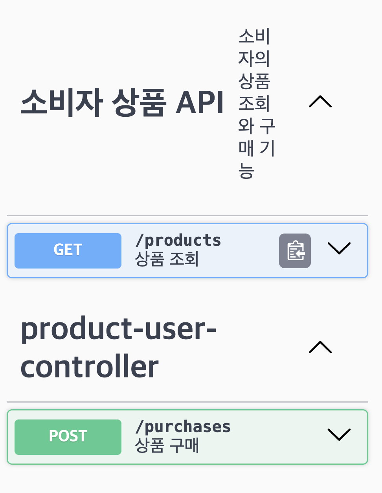
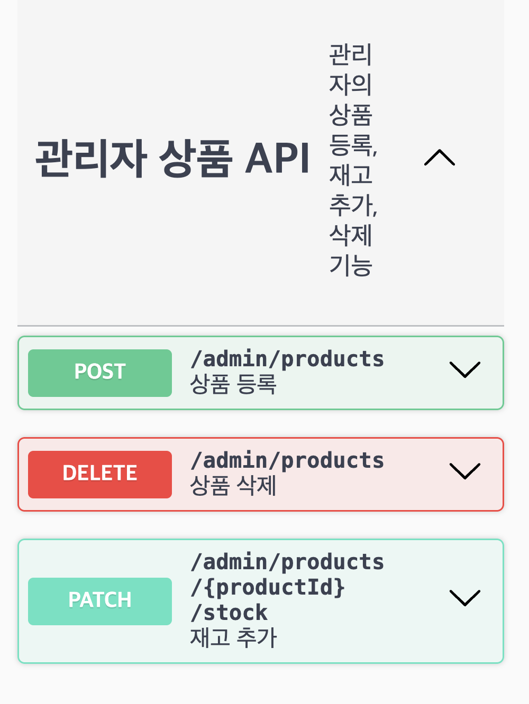

# Swagger API 문서

Swagger 어노테이션을 사용하여 쇼핑몰 API를 문서화했습니다.

- @Tag: 소비자 API와 관리자 API를 구분했습니다.
- @Operation: 각 API의 기능과 요청·응답 정보를 설명했습니다.
- @ApiResponse: 성공 응답의 상태 코드를 설명했습니다.
- @Schema: 상품 데이터의 필드와 예시를 설명했습니다.

## 소비자 API

상품 조회와 상품 구매 기능입니다.

## 관리자 API

상품 등록, 재고 추가, 상품 삭제 기능입니다.

